# Alur Sistem ERP — Navigasi, Bisnis & Data

Dokumen ini memetakan tiga lapis alur aplikasi:

| Bagian | Cakupan | Sumber kebenaran |
| --- | --- | --- |
| **A — Navigasi & User Journey** | Rute, guard, sidebar, kondisi halaman | `resources/js/router/index.js`, `layouts/navigation.js` |
| **B — Alur Bisnis per Modul** | Siklus dokumen & interaksi halaman | `resources/js/pages/*.vue` (data contoh) |
| **C — Alur Data / API** | Autentikasi, middleware, multi-tenant, RBAC | `routes/api.php`, `bootstrap/app.php`, `stores/auth.js` |

Diagram memakai Mermaid. Renderer GitHub/GitLab/VS Code akan menampilkannya otomatis.

> **Status saat ini:** modul **Sales, Finance, Manufacturing** belum punya halaman. Kunci izinnya sudah tersedia (37 total) tetapi belum ada rute maupun endpoint.

---

## 0. Arsitektur Ringkas

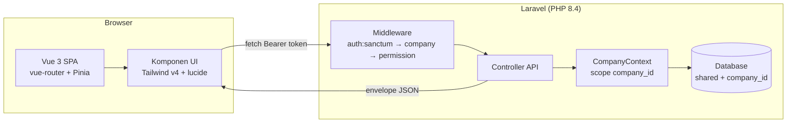

- **Auth:** Laravel Sanctum bearer token (disimpan di `localStorage`).
- **Multi-tenant:** database bersama + kolom `company_id`; penjaganya `SetCurrentCompany` + global scope yang **menolak secara bawaan** (`where 1 = 0`), dengan pintu keluar `CompanyContext::run()`.
- **RBAC ringan kustom:** 9 modul × aksi = **37 kunci izin**, 4 peran sistem, hanya-baca.

---

## A. Navigasi & User Journey

### A1. Guard router — dijalankan pada **setiap** navigasi

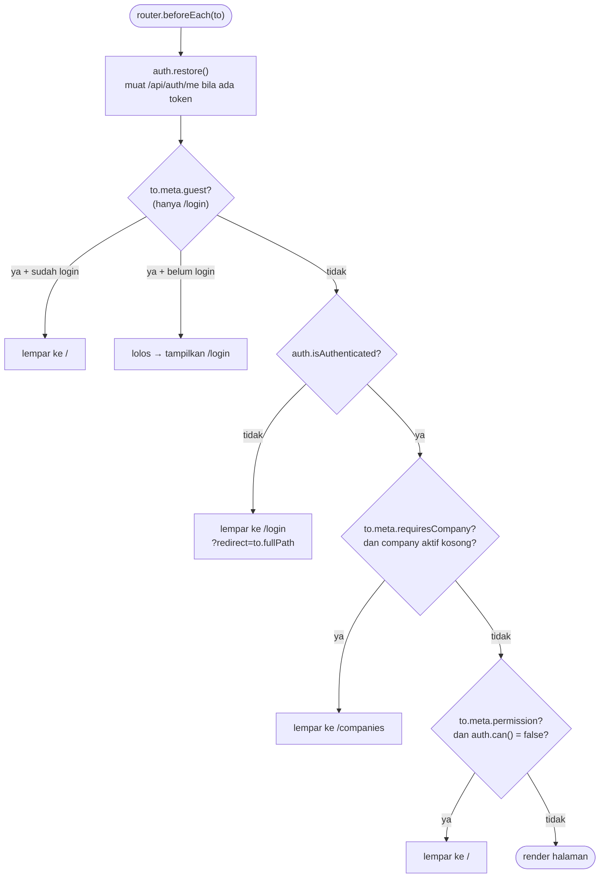

**Empat lapis penjaga:** `guest` → `requiresAuth` → `requiresCompany` → `permission`.
Catch-all `/:pathMatch(.*)*` dilempar ke `/`, jadi URL asing tidak pernah memunculkan halaman kosong.

### A2. Peta sidebar

Sumber: `layouts/navigation.js`. Item **tidak dirender** sama sekali bila izinnya tidak dimiliki.

| Grup | Item | Rute | Izin yang menampilkan |
| --- | --- | --- | --- |
| Umum | Dashboard | `/` | — (semua pengguna login) |
| Master Data | Katalog Produk | `/master-data` | `master.view` |
| Operasional | Inventory | `/inventory` | `inventory.view` |
| Operasional | Purchasing | `/purchasing` | `purchasing.view` |
| Pengaturan | Perusahaan | `/companies` | — |
| Pengaturan | Pengguna | `/users` | `users.view` |
| Pengaturan | Peran & Izin | `/roles` | `users.view` |
| — | Sales / Finance / Manufacturing / Laporan | *belum ada* | `sales.*`, `finance.*`, `manufacturing.*`, `report.view` |

### A3. Journey dua tipe pengguna

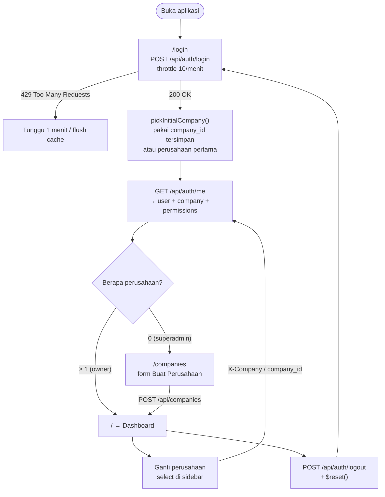

**Akun demo:** `owner@erp.test` / `password` (2 perusahaan → langsung Dashboard) · `superadmin@erp.test` / `password` (0 perusahaan → form buat perusahaan).

### A4. Kondisi yang bisa ditemui di halaman

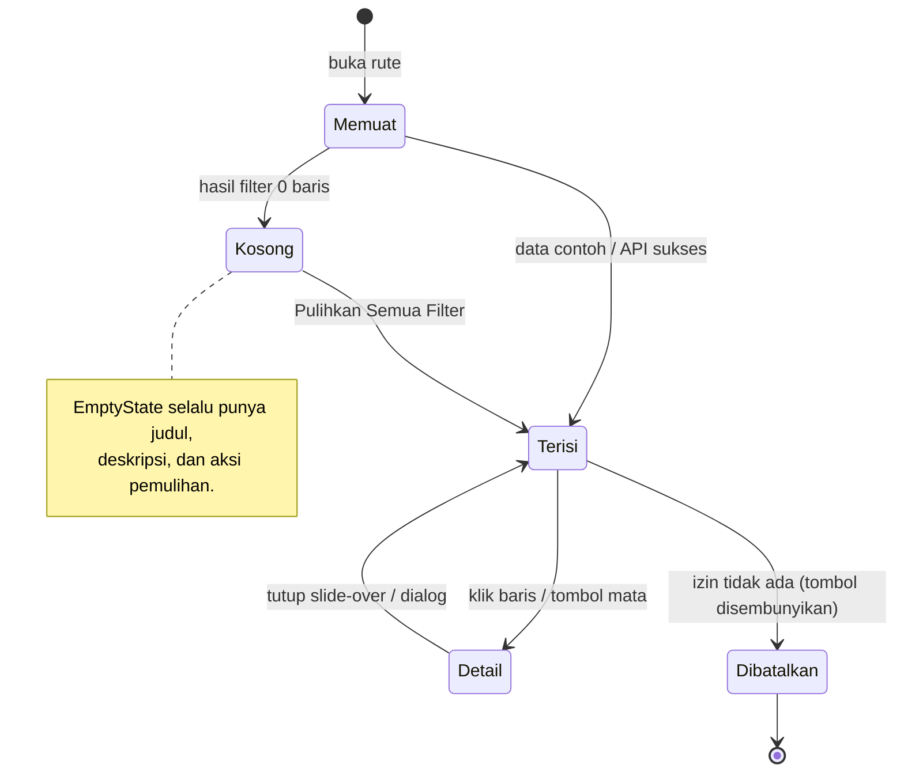

- **Tombol aksi** muncul/hilang mengikuti izin (`v-if="canCreate"` dll), bukan hanya jadi `disabled`.
- **Pagination baris 2+** sengaja `disabled` — datanya masih placeholder sampai endpoint terpasang; alasannya dikirim lewat `title`.
- **Toast** (`role="status"`) muncul di kanan-bawah selama 3 detik setelah aksi.

### A5. Shell aplikasi (`AppLayout`)

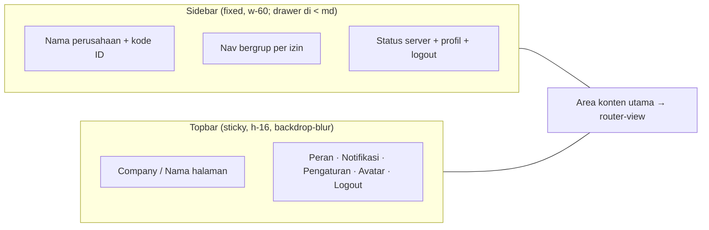

---

## B. Alur Bisnis per Modul

### B1. Purchasing — siklus Purchase Order

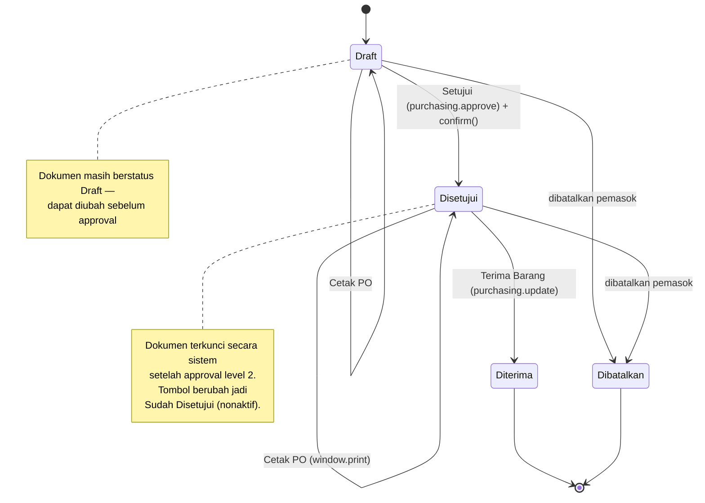

**Interaksi halaman:**

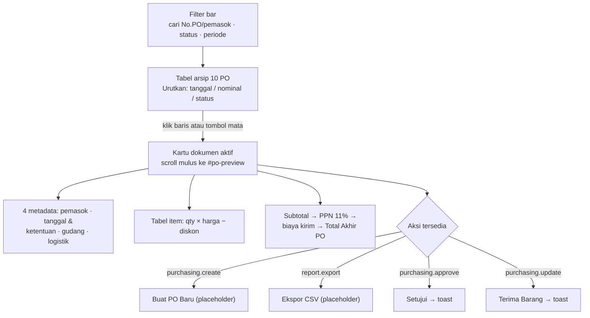

Semua angka keuangan **dihitung dari baris item**, bukan angka mati:
`total = subtotal + round(subtotal × 0,11) + biayaKirim`.

### B2. Inventory — empat tab

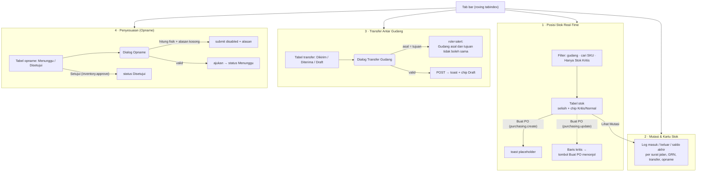

### B3. Master Data — slide-over tiga tab

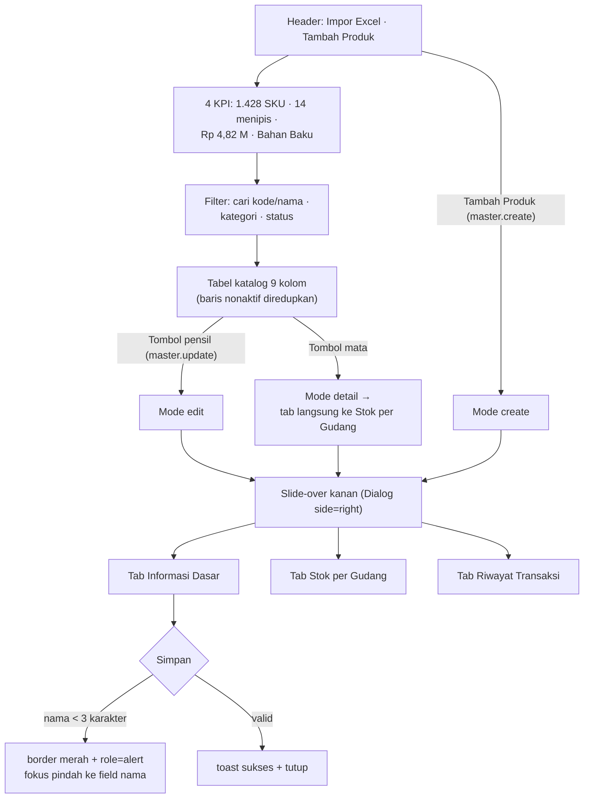

### B4. Dashboard — konsumen lintas modul

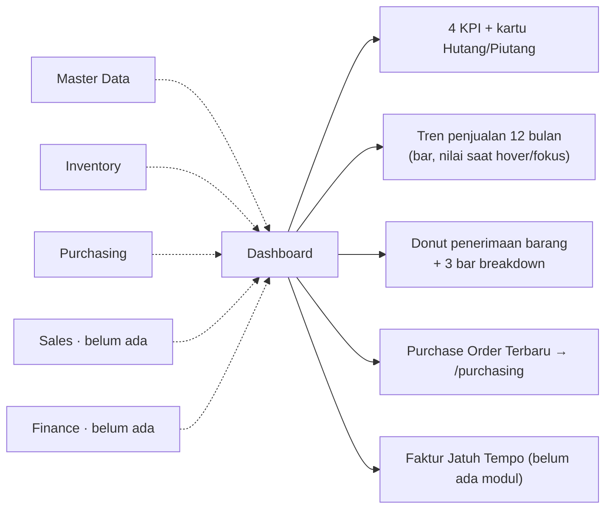

---

## C. Alur Data / API

### C1. Autentikasi & bootstrap sesi

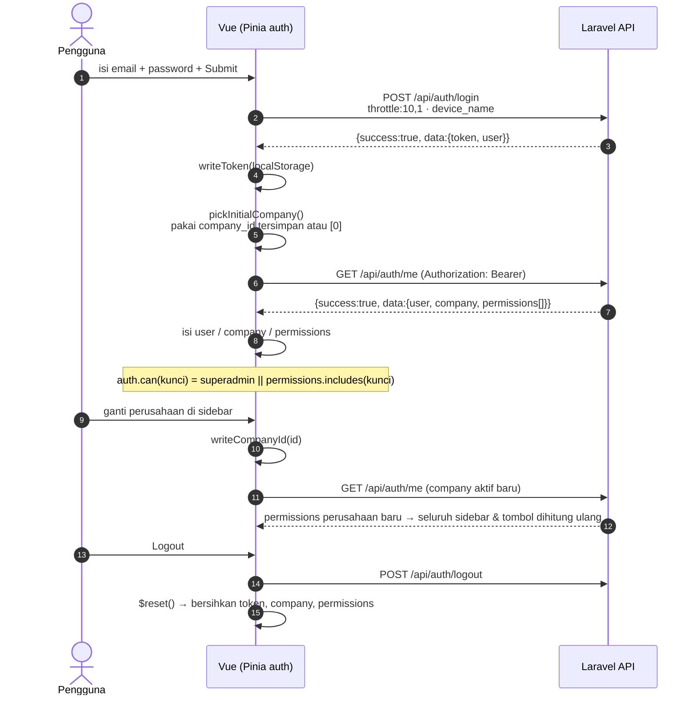

**Penyimpanan:** `localStorage` hanya memuat **token** dan **company_id aktif** — bukan daftar izin. Izin selalu diambil ulang dari `/api/auth/me`, sehingga pencabutan izin di server langsung berlaku pada muat ulang berikutnya.

### C2. Pipeline satu request API

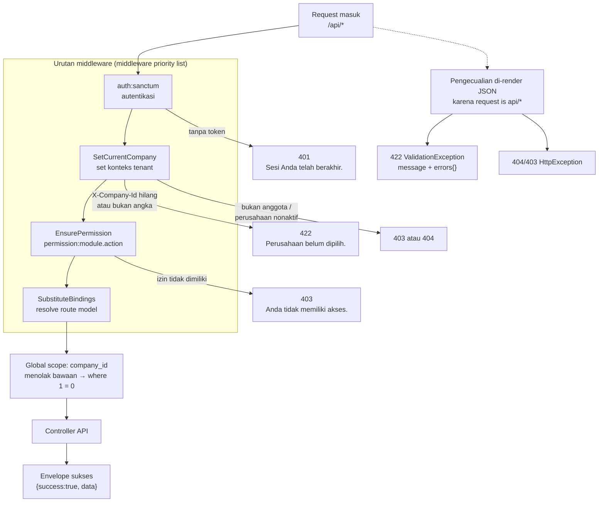

> **Urutan ini penting dan memang diatur lewat `prependToPriorityList(SubstituteBindings, …)` di `bootstrap/app.php`:**
>
> 1. **`auth:sanctum`** — menolak request tanpa token (401) sebelum ada pemeriksaan lain.
> 2. **`SetCurrentCompany`** — menyetel `CompanyContext` dari header `X-Company-Id` dan memastikan pengguna memang anggota perusahaan tersebut.
> 3. **`EnsurePermission`** — membaca `CompanyContext` lalu `user->canPerform($permission, $company)`; menolak (403) **sebelum** query apa pun berjalan. Middleware ini **wajib** berjalan setelah langkah 2, karena ia menganggap `company !== null`.
> 4. **`SubstituteBindings`** — resolve route model **paling akhir**, supaya konteks tenant dan izin sudah jelas sebelum database disentuh.

### C3. Bentuk respons (envelope)

```json
// Sukses
{ "success": true, "data": { "token": "...", "user": { } } }

// Gagal
{
  "success": false,
  "message": "Data yang diberikan tidak valid.",
  "errors": { "email": ["Kolom email wajib diisi."] }
}
```

Sisi klien membaca pola ini di `lib/errors.js` → pesan diterjemahkan ke Bahasa Indonesia lalu tampil sebagai toast atau error per-field.

### C4. RBAC — 37 kunci, 9 modul

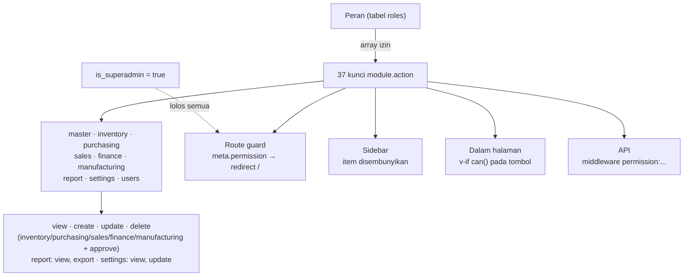

Empat lapis penjagaan yang sama-sama mengecek kunci yang sama — tidak ada pintu belakang: rute, sidebar, tombol, dan endpoint.

### C5. Peta endpoint

| Endpoint | Metode | Middleware | Status |
| --- | --- | --- | --- |
| `/api/auth/login` | POST | `throttle:10,1` | ✅ terpasang |
| `/api/auth/logout` · `/api/auth/me` | POST · GET | `auth:sanctum` | ✅ terpasang |
| `/api/companies` | GET · POST | `auth:sanctum` | ✅ terpasang |
| `/api/companies/{company}` | PATCH | `+ company` | ✅ terpasang |
| `/api/users` · `/api/roles` · `/api/permissions` | GET | `+ permission:users.view` | ✅ terpasang |
| `/api/users` · `/api/roles` | POST | `permission:users.create` | ✅ terpasang |
| `/api/users/{id}` · `/api/roles/{id}` | PATCH | `permission:users.update` | ✅ terpasang |
| `/api/users/{id}` · `/api/roles/{id}` | DELETE | `permission:users.delete` | ✅ terpasang |
| `/api/products` (Master Data) | — | `master.*` | ⏳ `TODO(M4)` — halaman sudah ada |
| `/api/inventory/*` (stok, mutasi, transfer, opname) | — | `inventory.*` | ⏳ `TODO(M3)` — halaman sudah ada |
| `/api/purchase-orders` (Purchasing) | — | `purchasing.*` | ⏳ `TODO(M5)` — halaman sudah ada |
| `/api/dashboard/*` | — | `report.view` | ⏳ `TODO(M2–M7)` |
| Sales · Finance · Manufacturing | — | kunci sudah tersedia | ⬜ belum ada halaman |

---

## Lampiran: Lokasi Kode Cepat

| Ingin mengubah… | Buka… |
| --- | --- |
| Rute / guard / izin halaman | `resources/js/router/index.js` |
| Item sidebar | `resources/js/layouts/navigation.js` |
| Shell (sidebar, topbar, drawer) | `resources/js/layouts/AppLayout.vue` |
| Sesi, ganti perusahaan, `auth.can()` | `resources/js/stores/auth.js` |
| Grup izin (tambah modul) | `app/Support/Permissions.php` |
| Urutan middleware & render error | `bootstrap/app.php` |
| Endpoint & topeng izin | `routes/api.php` |
| Warna & token tema | `resources/css/app.css` |
